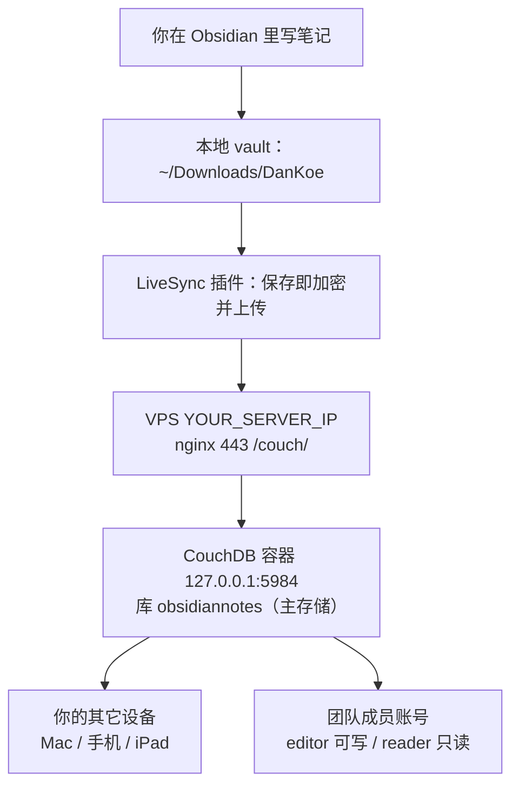

i# Obsidian 云端同步工作流

方案已换成 **Self-hosted LiveSync + 自建 CouchDB**（可用第三方的实时共编与 Git 已停用）。

## 日常怎么用

1. 打开 Obsidian 正常写，`Ctrl/Cmd + S` 保存后几秒内自动上传，不用点任何东西。
2. 换设备：装同样插件，填同样的 5 个参数（URI / 用户名 / 密码 / 库名 / E2E 口令），首次同步会把云端内容拉下来。
3. 给别人开权限：服务器 `_users` 建账号，`roles` 填 `["sync-user","editor"]` 可读写，填 `["sync-user","reader"]` 只读（写入会被服务端 403 拒绝）。
4. 断网也不丢：内容先落本地，恢复网络后自动补传。

## 数据在哪

- **主存储**：服务器 CouchDB（`/opt/couchdb/data`），文件被切成块、用 E2E 口令加密后存放。
- **本地**：完整 vault，离线可读可写。
- 服务器看到的是密文块，看不到正文；但能看出文档数量、大小、修改时间。

## 已停用的两条旧通道

| 通道 | 为什么停 |
|---|---|
| Live Share | 每次启动自动托管、和 LiveSync 双写同一 vault；且它只是中继，不存内容、没有权限管理 |
| Obsidian Git | 每 10 分钟 push 到同机裸仓库，算不上独立备份；且因文件名含空格一直报 `ambiguous argument` 死循环重试 |

需要「像 Google Docs 一样同时改同一段」时，临时启用 `live-share` → `Start session` → 用完关掉。
